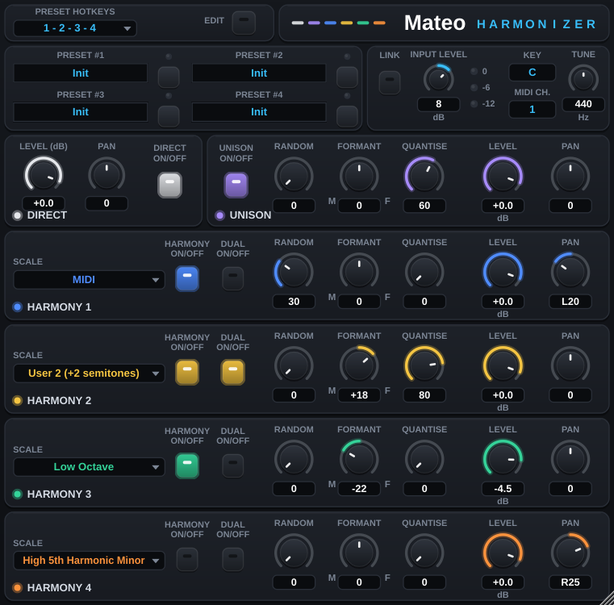

# Mateo Harmonizer – VST3 64-bit dla Windows

Harmonizer wokalny z układem jak w Akai DecaBuddy: głos DIRECT, UNISON i 4 głosy HARMONY (każdy z opcją DUAL, czyli w sumie do 10 głosów). Skórka jest nowoczesna, a okno można dowolnie powiększać (przeciągnij prawy dolny róg).

## Jak zbudować plik .vst3

### Sposób A: na swoim komputerze (Windows 10/11)
1. Zainstaluj **Visual Studio 2022 Community** (za darmo) i zaznacz pakiet **„Desktop development with C++”**. CMake jest w zestawie.
2. Zainstaluj **Git for Windows**: CMake pobiera nim bibliotekę JUCE przy pierwszym budowaniu, więc potrzebny jest też internet.
3. Kliknij dwukrotnie **`build.bat`**. Pierwsze budowanie trwa kilka minut.
4. Kliknij prawym przyciskiem **`install.bat`** i wybierz **„Uruchom jako administrator”**. Wtyczka trafi do `C:\Program Files\Common Files\VST3`.
5. W DAW (FL Studio, Ableton, Reaper, Cubase, Studio One…) odśwież listę wtyczek. Wtyczka nazywa się **Mateo Harmonizer** (producent: Mateo).

Dodatkowo powstaje wersja **Standalone** (`.exe`), która działa bez DAW:
`build\MateoHarmonizer_artefacts\Release\Standalone\Mateo Harmonizer.exe`

### Sposób B: bez instalowania czegokolwiek (GitHub)
1. Załóż nowe repozytorium na GitHubie i wgraj do niego zawartość tego folderu.
2. Na karcie **Actions** uruchomi się zadanie „Build Windows x64” (albo uruchom je ręcznie: *Run workflow*).
3. Po ok. 10 minutach pobierz gotowy plik **MateoHarmonizer-Windows-x64** z sekcji *Artifacts*.
4. Folder `Mateo Harmonizer.vst3` skopiuj do `C:\Program Files\Common Files\VST3`.

## Użycie w DAW
* Wstaw wtyczkę jako **efekt** na ścieżkę wokalu (mono lub stereo).
* Do skali **MIDI** (nuty harmonii grane z klawiatury) skieruj na wtyczkę ścieżkę MIDI. Jak to zrobić, zależy od DAW: w Reaperze przez routing (send MIDI), w Abletonie przez „MIDI To” na ścieżce MIDI, w FL Studio przez port MIDI.
* Wtyczka zgłasza opóźnienie ok. 40 ms, a DAW wyrównuje je automatycznie.
* Podwójne kliknięcie pokrętła przywraca wartość domyślną. Po najechaniu myszą na element pojawia się podpowiedź po polsku.

## Opis wszystkich funkcji

### Górny pasek
| Element | Działanie |
|---|---|
| **PRESET HOTKEYS** | Sposób przełączania presetów 1–4: klawisze **1-2-3-4**, klawisze **F1–F4**, komunikat **MIDI Program Change** (programy 1–4) albo **Off**. Klawisze działają, gdy okno wtyczki jest aktywne. |
| **EDIT** | Tryb edycji presetów. Gdy jest włączony (czerwony), kliknięcie przycisku presetu **zapisuje** w nim bieżące ustawienia, a kliknięcie nazwy pozwala ją zmienić. Gdy jest wyłączony, przycisk presetu **wczytuje** preset. |

### Presety
| Element | Działanie |
|---|---|
| **PRESET #1–#4** | Cztery pamięci kompletnych ustawień. Pole pokazuje nazwę, kwadratowy przycisk wczytuje (lub w trybie EDIT zapisuje) preset, a dioda nad nim pokazuje aktywny preset. Presety zapisują się razem z projektem DAW i są widoczne w DAW jako „programy”. |

### Sekcja globalna
| Element | Działanie |
|---|---|
| **LINK** | Gdy jest włączony, tonacja (KEY) automatycznie podąża za ostatnią nutą zagraną z MIDI. Możesz więc zmieniać tonację harmonii w trakcie utworu, grając jeden klawisz. |
| **INPUT LEVEL** (dB) | Wzmocnienie sygnału wejściowego (−24…+24 dB). Diody **−12 / −6 / 0** pokazują wysterowanie. Czerwona dioda 0 oznacza przesterowanie. |
| **KEY** | Tonacja (C…B) używana przez skale diatoniczne (High/Low 3rd, 4th, 5th, 6th). |
| **MIDI CH.** | Kanał MIDI, na którym wtyczka odbiera nuty i zmiany programów (**Omni** = wszystkie). |
| **TUNE** (Hz) | Strojenie, czyli częstotliwość A4 (430–450 Hz, domyślnie 440). |

### DIRECT (sygnał oryginalny)
| Element | Działanie |
|---|---|
| **LEVEL (dB)** | Głośność oryginalnego wokalu. |
| **PAN** | Panorama oryginału (L50…R50). |
| **DIRECT ON/OFF** | Włącza lub wyłącza oryginał. Po wyłączeniu słychać tylko wygenerowane głosy. |

### UNISON
Dodatkowy głos na tej samej wysokości (dubel).
| Element | Działanie |
|---|---|
| **UNISON ON/OFF** | Włącza lub wyłącza głos unisono. |
| **RANDOM** | Losowe, naturalne wahania wysokości (do ±35 centów), które dają efekt „drugiego wokalisty”. |
| **FORMANT** | Barwa głosu bez zmiany wysokości: **M** daje głos ciemniejszy (męski), **F** jaśniejszy (żeński). |
| **QUANTISE** | Korekcja do najbliższej nuty: 0 = naturalnie, 100 = idealnie w nutę (efekt autotune). |
| **LEVEL** (dB) | Głośność głosu. |
| **PAN** | Panorama głosu. |

### HARMONY 1–4
| Element | Działanie |
|---|---|
| **SCALE** | Interwał harmonii (opcje opisane niżej). |
| **HARMONY ON/OFF** | Włącza lub wyłącza głos harmonii. |
| **DUAL ON/OFF** | Dodaje drugi, lekko rozstrojony głos tej harmonii i rozsuwa oba w stereo (gęstszy chór). |
| **RANDOM / FORMANT / QUANTISE / LEVEL / PAN** | Działają tak samo jak w UNISON. QUANTISE ustala, jak dokładnie harmonia trafia w nutę skali. |

#### Opcje SCALE
* **MIDI**: harmonia śpiewa nutę zagraną na klawiaturze MIDI. Gdy kilka harmonii ma ustawione MIDI, dostają kolejne trzymane nuty od najniższej. Bez wciśniętego klawisza głos milknie.
* **High / Low Octave**: oktawa w górę lub w dół.
* **High / Low 3rd, 4th, 5th, 6th Major**: tercja, kwarta, kwinta lub seksta w górę albo w dół, zgodnie ze skalą durową w tonacji KEY.
* **… Minor**: to samo w skali molowej (naturalnej).
* **… Harmonic Minor**: to samo w skali molowej harmonicznej.
* **User 1–11**: stały interwał w półtonach (+1…+7 oraz −3, −4, −5, −7), niezależny od tonacji.

## Uwagi techniczne
* Wysokość dźwięku wykrywa algorytm YIN, a zmianę wysokości robi algorytm TD-PSOLA, który zachowuje naturalne formanty głosu. Pokrętło FORMANT przesuwa formanty niezależnie od wysokości.
* Harmonizer najlepiej działa na **jednogłosowym** wokalu, bez pogłosu. Najpierw harmonizer, potem pogłos.
* Na spółgłoskach i w ciszy harmonie automatycznie się wyciszają, a DIRECT i UNISON grają dalej.
* Pliki: `Source/dsp/MateoEngine.h` (silnik dźwięku), `Source/PluginProcessor.*` (parametry, presety, MIDI), `Source/PluginEditor.*` i `Source/ModernLookAndFeel.h` (wygląd).
* Test silnika (dowolny kompilator C++17): `g++ -O2 -std=c++17 tests/engine_test.cpp -o test && ./test`
